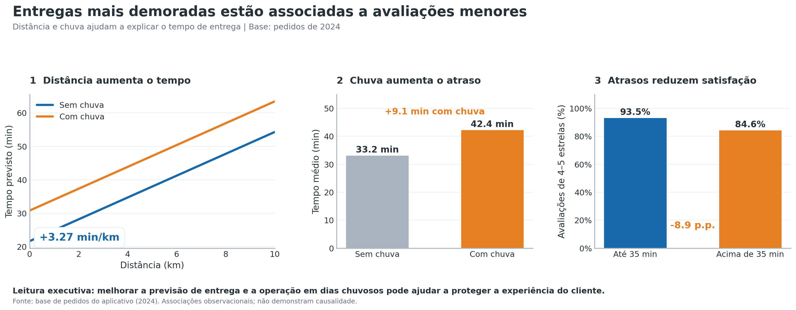

# Chuva e distância estão associadas a entregas mais demoradas e avaliações menores

> Diagnóstico de 8.058 pedidos de 2024: priorizar previsões logísticas ajustadas por distância e chuva, acompanhar satisfação e testar promoções segmentadas.



*Figura principal: distância e chuva relacionadas ao tempo de entrega e percentual de avaliações positivas por faixa de tempo; 8.058 pedidos analisados em 2024.*

---

## 1. Pergunta de negócio

A análise apoia a diretoria de um aplicativo de delivery no planejamento operacional e comercial. Investiga demanda, eficiência das entregas, satisfação dos clientes e oportunidades de segmentação por cupom e tipo de cozinha. O objetivo é transformar padrões observados em decisões monitoráveis, sem confundir associação estatística com causalidade.

**Perguntas que guiaram a análise:**
1. Em quais dias, horários e cidades se concentram os pedidos?
2. Como chuva e distância se relacionam com o tempo de entrega?
3. Entregas mais demoradas estão associadas a avaliações piores?
4. Como cupons se relacionam com o ticket e a participação de clientes novos?
5. O ticket varia entre tipos de cozinha? A forma de pagamento varia entre cidades?

## 2. Dados

- **Fonte:** `delivery_pedidos.csv`, base simulada disponibilizada no módulo DS-PY-018.
- **Período:** 01/01/2024 a 31/12/2024.
- **Escopo:** São Paulo, Rio de Janeiro e Belo Horizonte.
- **Tamanho:** 8.058 pedidos × 18 colunas na origem; 8.058 pedidos × 20 colunas na versão publicada.
- **Unidade de observação:** um pedido.
- **Base tratada:** `saidas/delivery_pedidos_limpo.csv`.
- **Dicionário automático:** `saidas/dicionario_dados.csv`.

### Dicionário da base limpa

| Coluna | Tipo | Descrição | Faltantes | Observação / tratamento |
|---|---|---|---:|---|
| `pedido_id` | inteiro | Identificador do pedido | 0,00% | Preservado |
| `data_hora` | data/hora | Registro temporal do pedido | 0,00% | Convertido para datetime |
| `cidade` | texto | Cidade de atendimento | 0,00% | Padronizada para três cidades |
| `bairro` | texto | Bairro do pedido | 0,00% | Preservado |
| `restaurante_id` | texto | Identificador do restaurante | 0,00% | Preservado |
| `tipo_cozinha` | texto | Categoria de culinária | 0,00% | Padronizada |
| `plataforma` | texto | Canal/plataforma do pedido | 0,00% | Ausentes classificados como “Não informada” |
| `forma_pagamento` | texto | Meio de pagamento | 0,00% | Categorias padronizadas |
| `cupom` | booleano | Indica utilização de cupom | 0,00% | Convertido de Sim/Não |
| `cliente_novo` | booleano | Indica cliente novo | 0,00% | Preservado |
| `chuva` | booleano | Indica chuva no pedido | 0,00% | Preservado |
| `distancia_km` | decimal | Distância estimada em quilômetros | 4,00% | Distâncias inválidas convertidas em ausentes |
| `tempo_entrega_min` | decimal | Tempo de entrega em minutos | 0,41% | Valores inválidos convertidos em ausentes |
| `valor_pedido` | decimal | Valor dos itens em reais | 0,00% | Convertido para numérico; extremos plausíveis mantidos |
| `taxa_entrega` | decimal | Valor da taxa de entrega em reais | 0,00% | Preservado |
| `avaliacao` | decimal | Avaliação do pedido (1 a 5) | 16,65% | Ausentes mantidos, sem imputação |
| `data` | data/texto | Data derivada do pedido | 0,00% | Criada de `data_hora` |
| `mes` | inteiro | Mês do pedido | 0,00% | Criada de `data_hora` |
| `hora` | inteiro | Hora do pedido | 0,00% | Criada de `data_hora` |
| `dia_semana` | categoria | Dia da semana | 0,00% | Criada de `data_hora` |

As flags e métricas intermediárias utilizadas durante a análise foram preservadas no notebook, mas excluídas do CSV publicado.

## 3. Como rodar

1. Clone o repositório `https://github.com/galvanirgalvao77-beep/TRABALHO_FINAL_GALVANIR` e abra sua pasta.
2. Utilize o Google Colab, que já oferece as principais bibliotecas de análise de dados. Para execução local, instale pandas, numpy, matplotlib, seaborn, scipy e statsmodels, conforme os imports do notebook.
3. Abra o notebook `projeto_final_Galvanir.ipynb` no Jupyter ou Google Colab.
4. No Google Colab, faça upload do arquivo original `delivery_pedidos.csv` para `/content/`, pois o notebook lê o CSV na pasta de execução. No Jupyter local, mantenha o CSV na mesma pasta do notebook ou ajuste o caminho usado na leitura.
5. Execute todas as células em ordem, a partir de um ambiente reiniciado, e confira a criação dos arquivos em `saidas/`.

**Observação:** o notebook foi desenvolvido no Colab. O CSV original está na raiz do repositório; no Colab, carregue-o novamente a cada sessão reiniciada, se necessário.

```bash
python -m pip install pandas numpy matplotlib seaborn scipy statsmodels notebook
jupyter notebook projeto_final_Galvanir.ipynb
```

**Reprodutibilidade:** a execução no Google Colab gerou a base limpa e o dicionário e passou pela validação da Tarefa 11.1, com 8.058 pedidos e 20 colunas. Para execução fora do Colab, confira dependências e caminhos. O tempo de execução e as versões exatas das bibliotecas não foram registrados.

## 4. Estrutura do repositório

```text
.
├── README.md
├── projeto_final_Galvanir.ipynb  # notebook completo
├── delivery_pedidos.csv         # base original, sem edição
└── saidas/
    ├── delivery_pedidos_limpo.csv
    ├── dicionario_dados.csv
    ├── figura_principal.png
```

## 5. Metodologia

1. **Perguntas e hipóteses:** definição de questões sobre logística, satisfação, cupons, pagamento e culinária.
2. **Carga e inspeção:** identificação de tipos incorretos, valores faltantes, inconsistências e colunas constantes.
3. **Limpeza:** padronização de categorias, conversão de datas e números e preservação dos 8.058 pedidos.
4. **Outliers:** separação entre valores impossíveis e pedidos de valor elevado plausíveis; extremos legítimos mantidos.
5. **Estatística descritiva:** comparação de média, mediana, dispersão, assimetria e percentis, considerando a influência de extremos.
6. **Sumarização e granularidade:** agregações por cidade, cozinha, mês, dia e hora, incluindo comparações normalizadas por dia.
7. **Visualização:** histogramas, barras, boxplots, séries temporais, mapas de calor e gráficos de relações entre variáveis.
8. **Correlação:** Spearman para associações monotônicas e avaliação da regra entre distância e taxa de entrega.
9. **Testes de hipótese:** Welch, Mann-Whitney, Spearman, Kruskal-Wallis, ANOVA, qui-quadrado e regressão múltipla; α = 5%.
10. **Conclusões:** priorização de cinco achados, três recomendações mensuráveis e três limitações.

### Decisões de limpeza

| Problema | Registros afetados | Decisão | Alternativa considerada |
|---|---:|---|---|
| `tempo_entrega_min` igual a 999 | 25 | Substituir por ausente | Excluir pedidos inteiros |
| `tempo_entrega_min` não positivo | 8 | Substituir por ausente | Excluir pedidos inteiros |
| `distancia_km` acima de 100 km | 7 | Substituir por ausente | Excluir pedidos inteiros |
| Distância originalmente ausente | 315 | Manter ausente | Imputar distância |
| Avaliação ausente | 1.342 | Manter ausente | Imputar avaliação média |
| Colunas `pais` e `moeda` constantes | 2 colunas | Remover da base tratada | Manter informação redundante |

## 6. Principais achados


*Figura principal: relação entre distância, condições climáticas, tempo de entrega e avaliações positivas, com base nos pedidos analisados em 2024.*

1. **Entregas com chuva levam, em média, 27,48% mais tempo.** As entregas realizadas com chuva demoram, em média, **9,13 minutos a mais** do que aquelas realizadas sem chuva (Tarefa 9.1 — teste t de Welch; p < 0,001). **Importância:** reforça a necessidade de planejamento logístico e ajuste das previsões de entrega em dias chuvosos.
2. **Cada quilômetro adicional está associado a 3,27 minutos adicionais de entrega.** A regressão múltipla, controlando a ocorrência de chuva, apresentou **R² = 0,637** (análise complementar da Tarefa 10.1). **Importância:** permite aprimorar as estimativas de prazo e o planejamento das rotas.
3. **Entregas acima de 35 minutos apresentam 8,93 pontos percentuais a menos de avaliações positivas.** O percentual de avaliações de 4 ou 5 estrelas passa de **93,49% para 84,57%** (Tarefa 9.3 — correlação de Spearman e teste de Mann-Whitney; p < 0,001). **Importância:** demonstra a relevância de monitorar a pontualidade como indicador de satisfação do cliente.
4. **Clientes novos representam 34,35% dos pedidos com cupom, contra 12,81% dos pedidos sem cupom.** A diferença é de **21,54 pontos percentuais** (Tarefa 9.5 — teste qui-quadrado; p < 0,001). **Importância:** sugere oportunidades para campanhas promocionais segmentadas, desde que acompanhadas dos custos e resultados de aquisição.
5. **O ticket mediano varia R$ 69,55 entre as categorias japonesa e doces.** A culinária japonesa apresenta mediana de **R$ 107,97**, enquanto doces registra **R$ 38,42** (Tarefa 9.4 — Kruskal-Wallis e ANOVA; p < 0,001). **Importância:** evidencia oportunidades de estratégias comerciais diferenciadas por tipo de cozinha.

**Síntese executiva:** A principal prioridade operacional é aumentar a previsibilidade das entregas, especialmente em dias chuvosos e trajetos longos. Comercialmente, os resultados apoiam a avaliação de campanhas segmentadas por perfil de cliente e categoria de cozinha. As relações identificadas são estatísticas e não comprovam causalidade.

### Hipóteses testadas (α = 5%)

| Hipótese | Teste | p-valor | Efeito | Decisão | Em linguagem de negócio |
|---|---|---|---|---|---|
| H1 — Chuva × tempo | Welch unilateral | < 0,001 | +9,13 min; d = 0,887 | Rejeitar H₀ | Chuva está associada a entregas mais demoradas |
| H2 — Cupom × ticket | Mann-Whitney bilateral | < 0,001 | Mediana −R$ 5,60; efeito por postos −0,119 | Rejeitar H₀ | Pedidos com cupom têm ticket mediano menor |
| H3 — Tempo × avaliação | Spearman e Mann-Whitney | < 0,001 | ρ = −0,244; −8,93 p.p. de avaliações positivas | Rejeitar H₀ | Maior demora acompanha menor satisfação |
| H4 — Cozinha × ticket | Kruskal-Wallis e ANOVA | < 0,001 | ε² = 0,406; η² = 0,151 | Rejeitar H₀ | Ticket difere entre categorias |
| H5 — Pagamento × cidade | Qui-quadrado | 0,6951 | V = 0,0155 | Não rejeitar H₀ | Não houve evidência de associação |
| Contraste — Cupom × cliente novo | Qui-quadrado | < 0,001 | V = 0,2324; +21,54 p.p. | Rejeitar H₀ | Cupons se associam a maior participação de novos clientes |
| H6 — Cidade × tempo de entrega | Kruskal-Wallis | 0,1844 | Médias de 35,71 a 36,34 min; amplitude 0,63 min | Não rejeitar H₀ | Não houve evidência suficiente de diferença nos tempos entre as três cidades |

## 7. Recomendações

| # | Recomendação | Achados que sustentam | Métrica para acompanhar |
|---|---|---|---|
| 1 | Ajustar previsões e escala de entregadores conforme chuva e distância | 1 e 2 | Tempo médio em dias chuvosos; base: 42,36 min |
| 2 | Monitorar entregas acima de 35 min e comunicar atrasos proativamente | 3 | % de avaliações 4–5 estrelas acima de 35 min; base: 84,57% |
| 3 | Testar cupons segmentados por perfil de cliente e cozinha | 4 e 5 | Custo de aquisição por novo cliente (CAC) por campanha |

## 8. Limitações

1. **Ausência de causalidade:** os testes identificam associações, mas não comprovam que cupons causam aquisição ou que a demora, isoladamente, causa avaliações piores.
2. **Qualidade e completude dos dados:** valores ausentes e inconsistências em avaliação, distância e tempo podem introduzir vieses e afetar estimativas.
3. **Escopo temporal e geográfico:** a base simulada cobre apenas 2024 e três capitais; resultados não são automaticamente generalizáveis para outros anos ou regiões.

## 9. Próximos passos

- Conduzir testes controlados de cupons e intervenções operacionais, coletando custos, para avaliar efeitos causais e retorno econômico.
- Acompanhar indicadores em períodos adicionais e novas cidades, registrando trânsito, disponibilidade de entregadores e tempo de preparo.
- Investigar o padrão de avaliações ausentes e avaliar a robustez dos resultados a esse mecanismo de ausência.

## 10. Autores

| Nome | GitHub | Principais contribuições |
|---|---|---|
| Galvanir Machado Galvão | [@galvanirgalvao77-beep](https://github.com/galvanirgalvao77-beep) | Preparação e limpeza de dados, análises, testes de hipóteses, visualizações, conclusões e documentação |

*Projeto final do módulo DS-PY-018 · Análise Exploratória de Dados · 2024 (período dos dados).*
